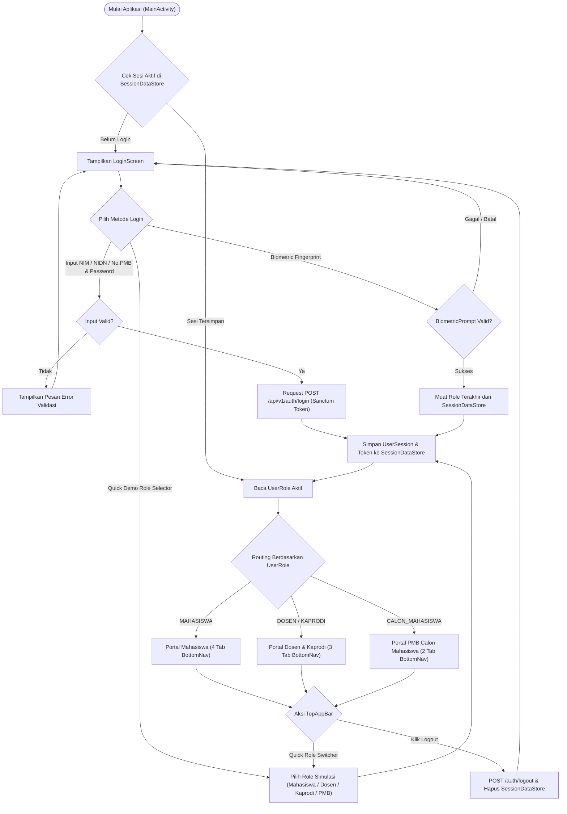
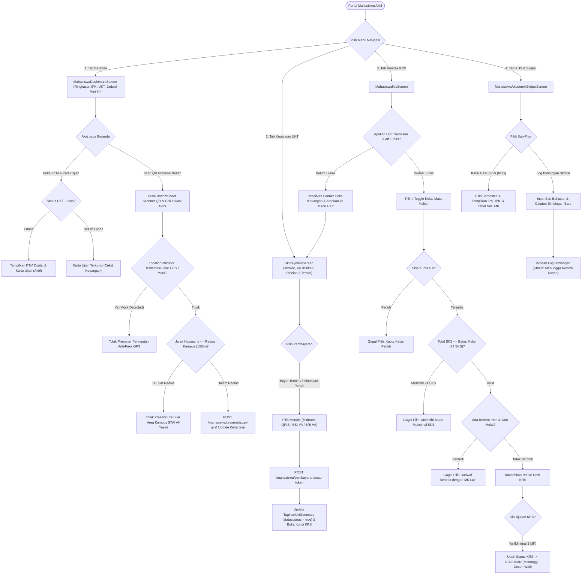
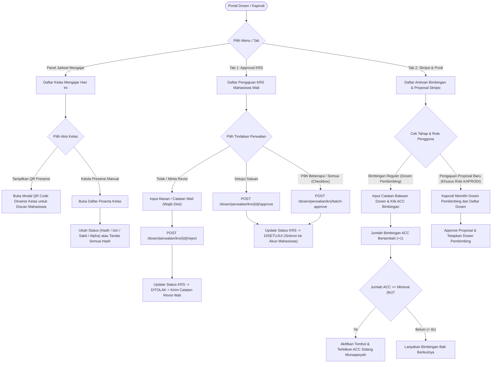
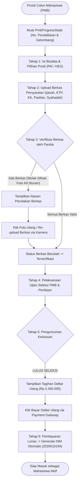
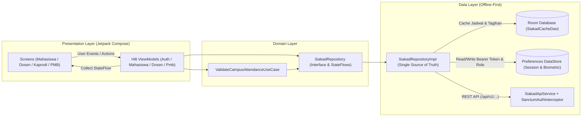

# Diagram Flowchart Sistem Mobile SIAKAD STAI Al-Yasini

Dokumen ini berisi rangkaian **Diagram Flowchart** yang merepresentasikan alur sistem, logika bisnis, dan arsitektur dari aplikasi **SIAKAD STAI Al-Yasini Mobile** berdasarkan implementasi kode sumber yang telah terbentuk.

---

## 1. Master Flowchart: Autentikasi & Multi-Role Routing

Merepresentasikan alur masuk pengguna pada [`AppNavHost.kt`](file:///Users/Maheswara/AndroidStudioProjects/siakad-kampus-alyasini-mobile/app/src/main/java/ac/id/staialyasini/siakad/presentation/navigation/AppNavHost.kt), [`LoginScreen.kt`](file:///Users/Maheswara/AndroidStudioProjects/siakad-kampus-alyasini-mobile/app/src/main/java/ac/id/staialyasini/siakad/presentation/auth/LoginScreen.kt), dan [`AuthViewModel.kt`](file:///Users/Maheswara/AndroidStudioProjects/siakad-kampus-alyasini-mobile/app/src/main/java/ac/id/staialyasini/siakad/presentation/auth/AuthViewModel.kt).

---

## 2. Flowchart Modul A: Mahasiswa Aktif (UKT, KRS, Presensi QR GPS, & Akademik)

Merepresentasikan alur terintegrasi antara pembayaran UKT, pencekalan KRS, validasi SKS/jadwal, presensi QR dengan radius GPS Haversine, serta bimbingan skripsi pada [`MahasiswaViewModel.kt`](file:///Users/Maheswara/AndroidStudioProjects/siakad-kampus-alyasini-mobile/app/src/main/java/ac/id/staialyasini/siakad/presentation/mahasiswa/MahasiswaViewModel.kt) dan [`SiakadRepositoryImpl.kt`](file:///Users/Maheswara/AndroidStudioProjects/siakad-kampus-alyasini-mobile/app/src/main/java/ac/id/staialyasini/siakad/data/repository/SiakadRepositoryImpl.kt).

---

## 3. Flowchart Modul B: Dosen Pengajar, Dosen Wali, & Kaprodi

Merepresentasikan alur kerja pada [`DosenDashboardApprovalScreen.kt`](file:///Users/Maheswara/AndroidStudioProjects/siakad-kampus-alyasini-mobile/app/src/main/java/ac/id/staialyasini/siakad/presentation/dosen/approval/DosenDashboardApprovalScreen.kt) dan [`DosenViewModel.kt`](file:///Users/Maheswara/AndroidStudioProjects/siakad-kampus-alyasini-mobile/app/src/main/java/ac/id/staialyasini/siakad/presentation/dosen/DosenViewModel.kt), termasuk pembedaan hak akses khusus **Kaprodi**.

---

## 4. Flowchart Modul C: Calon Mahasiswa Baru (PMB Tracker)

Merepresentasikan 6 tahapan seleksi Penerimaan Mahasiswa Baru pada [`PmbTrackerScreen.kt`](file:///Users/Maheswara/AndroidStudioProjects/siakad-kampus-alyasini-mobile/app/src/main/java/ac/id/staialyasini/siakad/presentation/pmb/PmbTrackerScreen.kt).

---

## 5. Flowchart Arsitektur Data Offline-First (Clean Architecture)

Merepresentasikan aliran data reaktif antara UI Compose, ViewModel, Repository, Room Database, DataStore, dan Retrofit REST API pada [`AppModule.kt`](file:///Users/Maheswara/AndroidStudioProjects/siakad-kampus-alyasini-mobile/app/src/main/java/ac/id/staialyasini/siakad/core/di/AppModule.kt) dan [`SiakadDatabase.kt`](file:///Users/Maheswara/AndroidStudioProjects/siakad-kampus-alyasini-mobile/app/src/main/java/ac/id/staialyasini/siakad/data/local/SiakadDatabase.kt).

